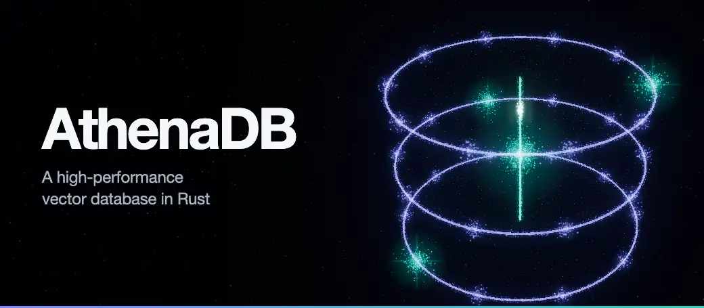
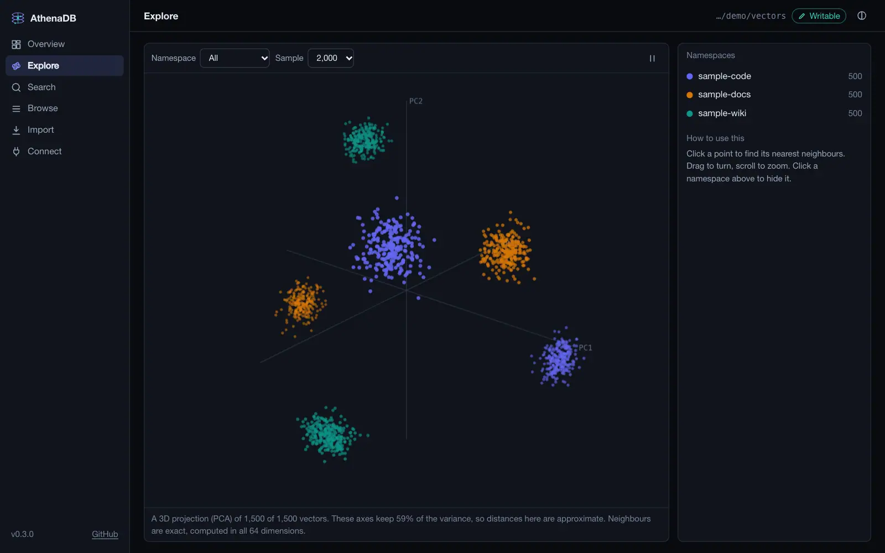
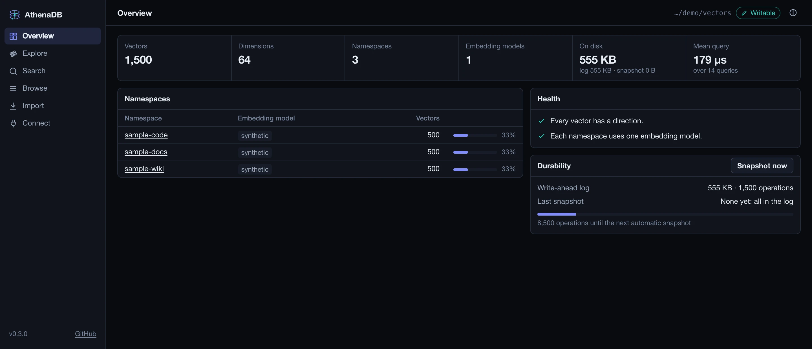
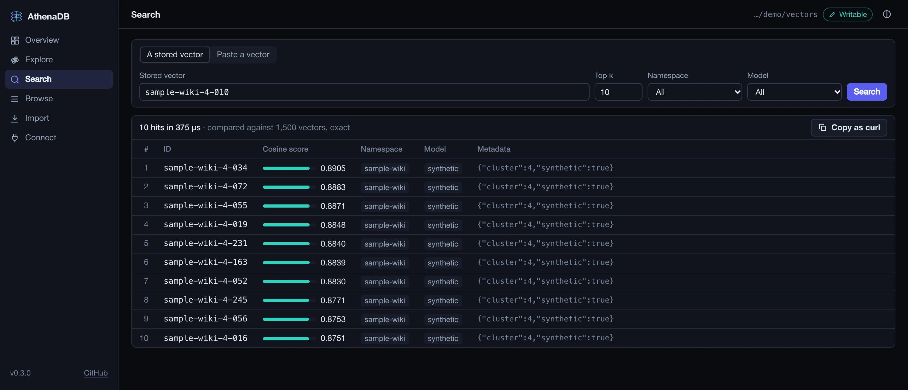
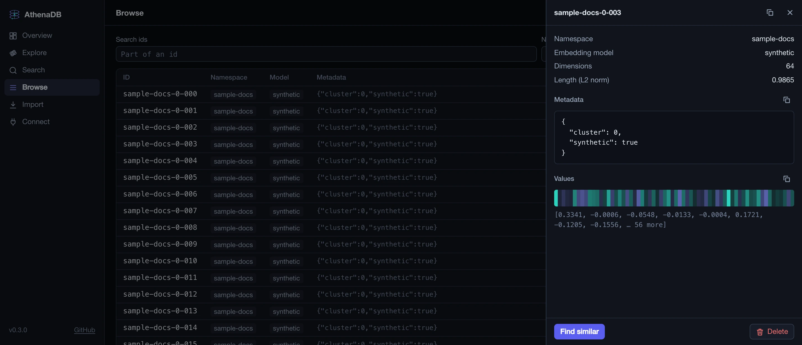
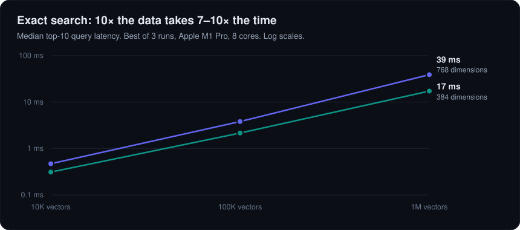

<div align="center">



**Exact vector search in Rust, with crash-consistent storage.**
<br />
Embed it in Python or Rust, with no server to run. When you want to look inside, a local dashboard is one command away.

[](https://github.com/aniketshukla1/athenadb/actions/workflows/ci.yml)
[](LICENSE)


**[Website](https://aniketshukla1.github.io/athenadb/)** · [Quick start](#quick-start) · [Dashboard](#dashboard) · [How it works](#how-it-works) · [Performance](#performance) · [API](#python-api) · [Roadmap](#status-and-roadmap)

</div>

---

## Why AthenaDB

<table>
<tr>
<td width="50%" valign="top">

**Fast without an index**

SIMD cosine over `wide::f32x8`, run in parallel with `rayon`. A top-10 query over
1,000,000 768-dimension vectors takes about 39 ms on an M1 Pro, and it is exact:
no recall to tune.

</td>
<td width="50%" valign="top">

**Survives `kill -9`**

Every write is appended to a log and fsynced before memory changes. Snapshots are
atomic. A write torn in half by a crash is detected and ignored on recovery.

</td>
</tr>
<tr>
<td valign="top">

**Embeddings stay in their lane**

Every vector records its `embed_model_id`, and queries can filter on it, so you
never compare vectors from incompatible models by accident.

</td>
<td valign="top">

**Multi-tenant from day one**

A namespace is a field on every vector, not a migration you run later.

</td>
</tr>
</table>

AthenaDB began as the memory engine for [Glaux](https://github.com/aniketshukla1/glaux),
a multi-agent swarm that signs its own work, and is developed as an independent project.

## Quick start

There's no package on PyPI yet, so build from source. You need a
[Rust toolchain](https://rustup.rs) and an active Python virtualenv.

```bash
git clone https://github.com/aniketshukla1/athenadb && cd athenadb
pip install maturin
maturin develop --release     # builds the module into your virtualenv
```

```python
import athenadb

db = athenadb.AthenaDB("./data")

db.add(
    ids=["cat", "kitten", "car"],
    vectors=[[0.9, 0.1, 0.0], [0.85, 0.2, 0.0], [0.0, 0.1, 0.95]],
    metadatas=['{"kind": "animal"}', '{"kind": "animal"}', '{"kind": "vehicle"}'],
    namespace="pets",
    embed_model_id="bge-small",
)

db.query([1.0, 0.0, 0.0], k=2, namespace="pets", embed_model_id="bge-small")
# [('cat',    0.9939, 'pets', 'bge-small', '{"kind":"animal"}'),
#  ('kitten', 0.9734, 'pets', 'bge-small', '{"kind":"animal"}')]
```

<details>
<summary><strong>The same thing in Rust</strong></summary>

```rust
use athenadb::core::Entry;
use athenadb::db::Database;

let mut db = Database::open("./data")?;

db.add(Entry {
    id: "cat".into(),
    vector: vec![0.9, 0.1, 0.0],
    metadata: serde_json::json!({ "kind": "animal" }),
    namespace: "pets".into(),
    embed_model_id: "bge-small".into(),
    inv_norm: 0.0, // computed on insert
})?;

for hit in db.search(&[1.0, 0.0, 0.0], 2, Some("pets"), Some("bge-small"))? {
    println!("{} {:.3}", hit.id, hit.score);
}
```

A complete version is in [`examples/quickstart.rs`](examples/quickstart.rs):
`cargo run --release --example quickstart`.

</details>

## Dashboard

<div align="center">

</div>

See what's in a store: turn it in 3D, click a point for its exact nearest neighbours, and
check its health. It's a single binary of about 2 MB, with nothing to build and nothing
loaded from the internet.

```bash
cargo install --git https://github.com/aniketshukla1/athenadb --features server
athenadb --data ./my-store --writable
```

Open <http://127.0.0.1:8001> and click **Load sample data** to try it on synthetic vectors.

<table>
<tr>
<td width="33%"></td>
<td width="33%"></td>
<td width="33%"></td>
</tr>
</table>

| Page | What it's for |
|---|---|
| **Overview** | Counts, disk use and query latency, plus warnings for zero vectors and mixed embedding models |
| **Explore** | A 3D PCA you can turn and zoom. Click a point for its neighbours, computed exactly in all dimensions |
| **Search** | Query by a stored id or a pasted vector, with filters, then copy it as `curl` |
| **Browse** | Filter and page through vectors, and open one to see its metadata and values |
| **Import** | Paste or drop JSON, checked before anything is written |
| **Connect** | Python, Rust and HTTP snippets for this store |

**Safe by default.** Without `--writable` it opens the store read-only, so you can inspect a
store another process is writing to, and reload when it changes. With `--writable` it owns the
store, and nothing else should write to it: two writers would corrupt the log. It listens on
loopback only, and needs `--token` (or `ATHENADB_TOKEN`) to listen anywhere else.

## How it works

<div align="center">

</div>

Search is a dot product against every vector, using reciprocal norms computed at
insert, so each comparison is a dot product plus one multiply. Each thread keeps a
bounded top-k heap, and the heaps are merged at the end.

## Performance

<div align="center">

</div>

| Vectors | 384 dimensions | 768 dimensions |
|---:|---:|---:|
| 10,000 | 0.31 ms | 0.47 ms |
| 100,000 | 2.15 ms | 3.81 ms |
| 1,000,000 | 17.2 ms | 39.0 ms |

Median top-10 query, best of 3 runs, on an Apple M1 Pro (8 cores, 16 GB). Measure it
on your own hardware (the largest case needs about 3 GB of RAM):

```bash
cargo test --release --test bench -- --ignored --nocapture
```

**Know the trade-off.** This is exact search, so latency grows with the size of the
corpus. It suits thousands to a few million vectors, where perfect recall matters
more than sublinear lookups. Each add also waits for an fsync, which favors durability
over insert speed, so add vectors in batches: `add` in Python takes a list, and Rust has
`add_batch`. If you need tens of millions of vectors today, you want an ANN index, which
is on the [roadmap](#status-and-roadmap).

## Durability

| What can go wrong | What happens | Proven by |
|---|---|---|
| Restart before any snapshot | The log replays on reopen | `reopen_recovers_from_wal` |
| Process killed mid-write | The torn final frame is ignored | `torn_wal_tail_is_ignored` |
| Restart after a snapshot | The snapshot loads, then the log tail replays on top | `snapshot_then_recover` |
| A delete before a crash | It stays deleted | `delete_persists` |
| A vector of the wrong dimension | Rejected before it reaches the log | `dim_mismatch_does_not_pollute_wal` |
| A batch with one bad vector | Nothing from it reaches the log | `batch_with_a_bad_dimension_logs_nothing` |
| Process killed mid-batch | Complete frames replay and the torn one is ignored, so a batch isn't atomic across a crash | `torn_tail_after_a_batch_keeps_the_intact_frames` |

All of these are tests in [`tests/persistence.rs`](tests/persistence.rs). Snapshots
are written to a temp file, fsynced and renamed, so a crash mid-snapshot leaves the
previous one in place. One is taken automatically every 10,000 operations, or on
demand with `db.snapshot()`.

## Python API

| Call | What it does |
|---|---|
| `AthenaDB(path)` | Open or create a database, recovering any prior state |
| `add(ids, vectors, metadatas=None, namespace=None, embed_model_id=None)` | Durably insert or overwrite, with one fsync per call. `metadatas` are JSON strings |
| `query(vector, k=10, namespace=None, embed_model_id=None)` | Top-k by cosine: `(id, score, namespace, embed_model_id, metadata_json)` |
| `scan(namespace=None, embed_model_id=None, limit=None, offset=0)` | List entries without ranking, with filters and pagination |
| `delete(ids)` | Durably delete, returning how many existed |
| `snapshot()` | Write a snapshot now and truncate the log |
| `len(db)` | The number of vectors stored |

## HTTP API

The `athenadb` binary serves this beside the dashboard. Every error has the same shape:
`{"error": {"code", "message", "details"?}}`.

| Endpoint | What it does |
|---|---|
| `GET /api/stats` | Counts, namespaces, disk use and query timing |
| `GET /api/vectors` | List vectors. Filters: `namespace`, `embed_model_id`, `q`. Paging: `limit`, `offset` |
| `POST /api/vectors` | Add or overwrite a batch, with one fsync per request |
| `GET /api/vectors/:id` | One vector, with its values |
| `DELETE /api/vectors/:id` | Delete. Safe to retry |
| `POST /api/search` | Top k by cosine, from `{"id"}` or `{"vector"}`, with optional filters |
| `GET /api/projection` | A 3D PCA of a sample of the store |
| `POST /api/snapshots` | Write a snapshot now and empty the log |
| `POST /api/reload` | Read-only servers: load the store from disk again |

Writes return `403` unless the server was started with `--writable`.

## Status and roadmap

| | |
|---|---|
| **Shipped** | SIMD cosine search, parallel top-k, namespaces, model tags, write-ahead log, atomic snapshots, crash recovery, `scan`, Python bindings, HTTP API, dashboard |
| **Planned** | ANN index (HNSW or IVF), group commit across concurrent writers, a re-embedding pipeline keyed on `embed_model_id` |

## Project layout

| Path | Role |
|---|---|
| [`src/core.rs`](src/core.rs) | `VectorStore`, SIMD cosine, parallel top-k |
| [`src/wal.rs`](src/wal.rs) | Append-only write-ahead log |
| [`src/snapshot.rs`](src/snapshot.rs) | Atomic point-in-time snapshots |
| [`src/db.rs`](src/db.rs) | `Database`: the durable store tying them together |
| [`src/python.rs`](src/python.rs) | PyO3 bindings (`--features python`) |
| [`src/server.rs`](src/server.rs) | HTTP API and its guards (`--features server`) |
| [`src/bin/athenadb.rs`](src/bin/athenadb.rs) | The `athenadb` command |
| [`src/projection.rs`](src/projection.rs) | The 3D PCA behind Explore |
| [`dashboard/`](dashboard) | The UI, embedded in the binary. Plain ES modules, no build step |

## Development

```bash
cargo test --features server              # Rust tests, including the HTTP API
maturin develop --release && pytest -q    # Python binding tests
```

## License

[Apache License 2.0](LICENSE): permissive, with an explicit patent grant.
